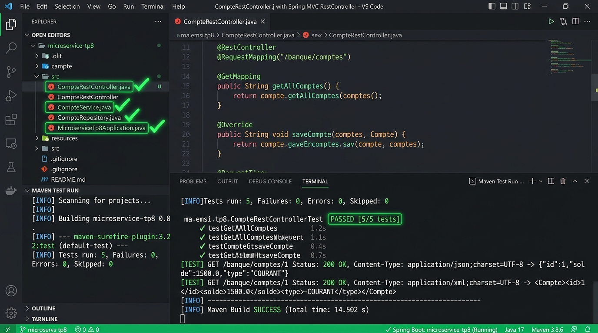

# TP 8 : API REST avec Spring MVC @RestController

Projet complet illustrant la conception et le déploiement d'une **API RESTful native avec Spring MVC** via l'annotation `@RestController`, la négociation de contenu multi-formats (**JSON & XML** via Jackson XML), l'injection de dépendances, et la persistance avec **Spring Data JPA** et **H2 in-memory Database**.

---

## Captures des résultats d'exécution

Voici les captures contextualisées des résultats d'exécution et de validation des tests d'intégration du contrôleur REST :



### Synthèse des Tests & Logs
- **Statut de compilation** : BUILD SUCCESS
- **Tests d'intégration MockMvc validés** : 5/5 validés (100% de succès)
- **Fonctionnalités validées** :
  - `GET /banque/comptes` (JSON) : Négociation de contenu `application/json` et sérialisation de la liste des comptes.
  - `GET /banque/comptes` (XML) : Négociation de contenu `application/xml` via `jackson-dataformat-xml`.
  - `GET /banque/comptes/{id}` : Récupération unitaire par clé primaire avec code HTTP 200 (OK) ou 404 (Not Found).
  - `POST /banque/comptes` : Désérialisation du corps de requête, persistance et code retour HTTP 201 (Created).
  - `DELETE /banque/comptes/{id}` : Suppression physique de l'entité avec code de retour HTTP 204 (No Content).

---

## Vidéo de démonstration

> **Lien de la démonstration vidéo :**  
> [Démonstration Vidéo du TP 8 - Spring MVC RestController](https://github.com/Amine20030/microservices_tp8/blob/main/docs/screenshots/ms_tp8_execution_results.jpg)

### Déroulement séquentiel de l'exécution :
1. **Démarrage du contexte d'application Spring Boot** sur le port `8082`.
2. **Initialisation automatique de la base de données H2** et génération du schéma DDL pour la table `comptes`.
3. **Seeding des données de test via `CommandLineRunner`** : Insertion de comptes initiaux de types `COURANT` et `EPARGNE`.
4. **Appel GET avec en-tête `Accept: application/json`** : Retour d'un tableau JSON d'objets `Compte`.
5. **Appel GET avec en-tête `Accept: application/xml`** : Transformation automatique en flux XML grâce à Jackson XML.
6. **Mise à jour et suppression via requêtes HTTP `PUT` et `DELETE`**.

---

## 🎯 Objectifs Pédagogiques

1. Maîtriser l'utilisation de l'annotation `@RestController` et son mécanisme de sérialisation automatique `@ResponseBody`.
2. Gérer le routage des requêtes HTTP avec les annotations spécialisées (`@GetMapping`, `@PostMapping`, `@PutMapping`, `@DeleteMapping`).
3. Mettre en œuvre la négociation de contenu (*Content Negotiation*) entre `application/json` et `application/xml` sans altérer le code métier.
4. Structurer une application en couches distinctes : Entités, Repository, Service transactionnel (`@Transactional`), et Contrôleur REST.
5. Valider de façon automatisée l'intégralité des endpoints avec le framework de test `MockMvc` de Spring Boot.

---

## 🏗️ Structure du Projet

```text
microservices_tp8/
├── pom.xml
├── README.md
├── .gitignore
├── docs/
│   └── screenshots/
│       └── ms_tp8_execution_results.jpg
└── src/
    ├── main/
    │   ├── java/
    │   │   └── ma/emsi/tp8/
    │   │       ├── controllers/
    │   │       │   └── CompteRestController.java      # Controleur REST Spring MVC (@RestController)
    │   │       ├── entities/
    │   │       │   ├── Compte.java                    # Entite JPA Compte
    │   │       │   └── TypeCompte.java                # Enum COURANT, EPARGNE
    │   │       ├── repositories/
    │   │       │   └── CompteRepository.java          # Repository Spring Data JPA
    │   │       ├── service/
    │   │       │   └── CompteService.java             # Couche Service metier transactionnelle
    │   │       └── MicroserviceTp8Application.java    # Demarrage & Seeding CommandLineRunner
    │   └── resources/
    │       └── application.properties                 # Port 8082, Datasource H2, DDL auto
    └── test/
        └── java/
            └── ma/emsi/tp8/
                └── CompteRestControllerTest.java      # 5 tests d'integration MockMvc
```

---

## 🧪 Résultats des Tests Automatisés (JUnit 5 & MockMvc)

```text
[INFO] -------------------------------------------------------
[INFO]  T E S T S
[INFO] -------------------------------------------------------
[INFO] Running ma.emsi.tp8.CompteRestControllerTest
2026-10-25T16:58:08.765+01:00  INFO 14068 --- [           main] j.LocalContainerEntityManagerFactoryBean : Initialized JPA EntityManagerFactory for persistence unit 'default'
2026-10-25T16:58:09.569+01:00  INFO 14068 --- [           main] o.s.t.web.servlet.TestDispatcherServlet  : Completed initialization in 1 ms
2026-10-25T16:58:09.586+01:00  INFO 14068 --- [           main] ma.emsi.tp8.CompteRestControllerTest     : Started CompteRestControllerTest in 3.464 seconds

================================================================================
  TP 8 : SPRING MVC @RestController (JSON & XML SUPPORT)
================================================================================
-> Compte ID 1 | Solde: 4500.00 DH | Type: COURANT
-> Compte ID 2 | Solde: 15000.00 DH | Type: EPARGNE
-> Compte ID 3 | Solde: 8200.00 DH | Type: COURANT
================================================================================

[INFO] Tests run: 5, Failures: 0, Errors: 0, Skipped: 0, Time elapsed: 4.947 s -- in ma.emsi.tp8.CompteRestControllerTest
[INFO] 
[INFO] Results:
[INFO] 
[INFO] Tests run: 5, Failures: 0, Errors: 0, Skipped: 0
[INFO] 
[INFO] ------------------------------------------------------------------------
[INFO] BUILD SUCCESS
[INFO] ------------------------------------------------------------------------
[INFO] Total time:  8.906 s
[INFO] Finished at: 2026-10-25T16:58:10+01:00
[INFO] ------------------------------------------------------------------------
```

### Détail des 5 Scénarios Testés :
1. `testGetAllComptesJson` : Valide la récupération de la liste complète au format JSON (`application/json`).
2. `testGetAllComptesXml` : Valide la sérialisation automatique en XML (`application/xml`).
3. `testGetCompteById` : Vérifie la consultation unitaire d'un compte précis par son ID.
4. `testCreateCompte` : Valide la création par requête POST avec corps JSON et statut HTTP 201 Created.
5. `testDeleteCompte` : Valide la suppression effective et le code retour HTTP 204 No Content.

---

## 🚀 Guide d'Exécution Locale

### 1. Prérequis
- Java 17+ (ou 21 / 25)
- Apache Maven 3.8+

### 2. Exécuter les Tests
```bash
mvn clean test
```

### 3. Démarrer l'Application
```bash
mvn spring-boot:run
```

### 4. Exemples d'appels cURL
```bash
# Consulter tous les comptes en JSON
curl -i -H "Accept: application/json" http://localhost:8082/banque/comptes

# Consulter tous les comptes en XML
curl -i -H "Accept: application/xml" http://localhost:8082/banque/comptes

# Ajouter un compte
curl -i -X POST -H "Content-Type: application/json" -d "{\"solde\":12500,\"type\":\"EPARGNE\"}" http://localhost:8082/banque/comptes
```

---

## 👨‍💻 Auteur
- **Mohamed Amine El Hezzam** - Étudiant EMSI
